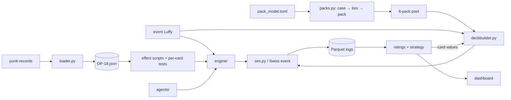

# OP18 Sealed Simulator: Plan

Goal: simulate the OP-18 release event (sealed, 6 packs, event Luffy leader) with bots that open packs, build decks and play Swiss rounds. Output per-card ratings and strategy findings.

## Status

| Area | State |
|---|---|
| Card data | `make fetch cards` builds `data/cards/OP-18.json` from punk-records `english` (North American text, pack `569118`): 119 set cards plus 6 reprint SPs, each with its parallel printings' rarities. |
| Event | Event Luffy is the only leader (`data/leaders/event_luffy.json`, `optcg.event`). Format lives in `config/event.toml`. |
| Pack model (M1) | Built. OP-18 estimates with sources in `config/pack_model.toml`. `make pools` reports pool statistics. |
| Engine (M2) | Vanilla rules done: turn structure, mulligan, DON!!, attacks, blocking, counters, K.O., life damage, Rush / Double Attack / Banish / Blocker, win by life or deck-out. Missing: card effects, Events, Stages, Trigger resolution, Unblockable, invariant fuzzer, benchmark. |
| Effects (M3) | Not started. This is the largest remaining piece. |
| Agents (M4) | Random and heuristic bots exist. Weight tuning and ISMCTS are not started. |
| Deckbuilder (M5) | Greedy stat-based builder exists, Characters only (the engine can't resolve Events or Stages yet). |
| Simulation (M6) | `make sealed` plays games between freshly opened decks. Swiss event simulation and Parquet logging are not started. |
| Stats / report (M7–M9) | Not started. |

## Locked decisions

| Topic | Decision |
|---|---|
| Leader | Event Luffy in every simulation: 5 life, 5000 power. Leaders opened in packs take pack slots but are never played. |
| Luffy rules | Counts as every name, type and attribute in any check against the Leader. Is not a Character. No other effect (confirmed). |
| Event format | 16–32 players, Swiss, Bo1 matches, ceil(log2 N) rounds, so exactly one player finishes undefeated and wins the prize. 6 packs per player, 4 players per box. |
| Deck | 40 cards plus 10 DON!!. Colours ignored, no copy limit. Unused cards form the sideboard. |
| Card text | punk-records `english`. Its `packs.json` was empty for OP-18, so the loader finds the pack by card-ID prefix. |
| Engine | Our own. No reusable open-source OPTCG engine exists. |

## How event Luffy changes OP18

30 cards in the pool refer to the Leader's name or type. Verified by scanning the card text:

- **Always on.** These conditions are true for every deck:
  - "If your Leader has the {X} type": OP18-007, 008, 013, 015, 082, 095, 097.
  - "Leader's type includes 'Baroque Works'": 046, 047, 050.
  - **11 CP Trigger cards**: 099, 100, 101, 103, 105, 107, 109, 113, 114, 115, 116.
  - Named-Leader checks: 020 (Vivi), 071 (Sugar), 117 (Spandam), and the reprint OP17-040 (Rocks Pirates).
- **Luffy is a legal target.** "{East Blue} type Leader or Characters" (023) and "{Dressrosa} type Leader or Characters" (042).
- **Work anyway**, because they name Luffy: 027 and 028.
- **Never fire.** 080 depends on "[Marshall.D.Teach] Leader's effect", and Luffy has no such effect. "You have a [X] Character" checks never match the Leader: 081 (Oars), 092, ST24-004.
- No OP18 card checks the Leader's colour or attribute, so Luffy's colours are irrelevant. 7 cards reference Leader power, so the 5000 base matters.

Expect the CP Trigger package to rate highly. Confirm it's a real effect and not an engine bug before trusting it.

## Architecture

## Milestones

### M0: Repo hygiene (done)
- GitHub repo `alvehn/optcg-sealed-sim`.
- `pyproject.toml` (stdlib only at runtime; pytest and ruff for dev), `make setup`.
- GitHub Actions CI runs `make lint test`.

### M1: Pack model and pool generator (built)

**Model** (`config/pack_model.toml`). Bandai publishes no rates, so every number is tagged CONFIRMED, ESTIMATE or ASSUMED:

| Item | Value | Status / source |
|---|---|---|
| Pack / box / case | 12 cards / 24 packs / 12 boxes | Confirmed |
| Slots per pack | 6 Common, 3 Uncommon, 2 Rare (one is the hit slot), 1 flex (Leader or Common, 50/50) | Assumed. A retailer lists English packs as 7–8 C, 3 UC, 1 R, 1 R-or-higher; Zatu says 2 cards per pack are guaranteed R or higher |
| SR | 7 or 8 per box (mean 7.25), different cards in different packs | Estimate. TCGTalk OP18 tally: 87 regular SR in a 12-box case |
| SEC-tier | 7–9 per case | Estimate. 9 and 7 in the two tallied cases |
| Alt arts | 17–18 per case, uniform over parallel printings, mapped to the base card | Estimate. Uniform odds give 25% Leader / 43% SR / 32% Rare, matching the case-1 tally of 4/8/6 |
| SP | 1–3 per case: Special printings and the 6 reprints | Estimate |
| Treasure Rare | ~1 per case, OP18-049 Mr.2 | Estimate |
| Gold DON!! | Left out | Unknown whether it takes a card slot; it would change fewer than 0.1 Rares per pool |
| Within a rarity | Every card equally likely | Assumed (no print-sheet data) |
| God packs | Ignored | Too rare to change pools |

**Sampler:** schedules case-level hits across the case's 288 packs, then each box's SRs in its remaining packs, with at most one hit per pack. Each player gets 6 consecutive packs from one box. Leaders are dropped from what the deckbuilder sees.

**Results** (`make pools EVENTS=2000`, 48,000 pools):
- 68.9 playable cards per pool on average (range 64–72), so the deckbuilder cuts about 29.
- 1.97 SR per pool (alt-art SRs included). 6.5% of pools have no SR, 7.0% have 4 or more.
- Chance a given card is in a pool: Common 61%, Uncommon 47%, Rare 32%, SR 20%, each SEC 6%, each SP under 1%.

That last line matters for rankings. A strong SR shows up in about 1 pool in 5, so a strong common can be worth more to the field.

**Still to do:**
- Calibrate the slot layout from a recorded English OP-18 opening (rarity per slot, per pack). This is the one input that changes pool composition.
- Pack-model sensitivity run (M10).

### M2: Game engine core (vanilla rules done)
The engine is a state machine. `legal_actions(state)` lists the deciding player's options and `apply(state, action)` advances the game. State is seeded and copyable for search.

Done:
- Setup, mulligan, life, turn structure and going-first rules.
- Playing Characters, with the 5-Character limit.
- DON!! attachment.
- Attacks, blocking, counter step, K.O., life damage.
- Rush, Double Attack, Banish, Blocker.
- Win or loss by life or deck-out.

To do:
- Trigger reveal and choice (life cards currently go straight to hand).
- Unblockable, [On Block], [When Attacking].
- Events, Stages, Counter events (all through M3).
- Paired-ablation shuffling: shuffle by deck slot index, so a swapped card lands in the same position.
- An invariant fuzzer over random-vs-random games. Card count stays constant across zones, the field holds at most 5 Characters, and DON!! never exceeds 10.
- `make bench` for games per second.
- Rules tests per Comprehensive Rules v1.2.1 (2026-08-28) section.

**Done when:** 100k random-vs-random games run with no exceptions or invariant violations.

### M3: Effect system and card scripts
- **Format:** card effects are written in a small data format and compiled into handlers. Each card can drop to a Python function when the format doesn't fit.
- **Timings** (number of OP18 cards using each):

  | Timing | Cards |
  |---|---|
  | On Play | 41 |
  | Trigger | 20 |
  | Activate: Main | 15 |
  | On K.O. | 15 |
  | Once Per Turn | 13 |
  | DON!! −N | 9 |
  | Counter | 8 |
  | When Attacking | 7 |
  | Opponent's Turn | 6 |
  | End of Your Turn | 6 |

- **Effect primitives** (approximate, counted with regex):

  | Primitive | Cards |
  |---|---|
  | Draw | 26 |
  | Power +N | 26 |
  | Bottom-deck | 18 |
  | Trash from hand as a cost | 14 |
  | Play from trash | 13 |
  | Look at top N | 10 |
  | Life manipulation | 9 |
  | Rest | 8 |
  | Can't attack/block | 7 |
  | Power −N | 6 |
  | Play from hand | 6 |
  | K.O. | 5 |
  | Set active | 3 |
  | Bounce | 2 |
  | Give DON!! | 2 |

  Target filters such as "cost N or less" appear on about 36 cards.
- **Leader checks**, implementing the semantics above. The flags come from `LeaderRules` in `optcg.event`:
  - `leader_has_type` and `leader_is_named` are always true for Luffy.
  - Target filters that say "Leader or Characters" include Luffy.
  - `controls_character(name|type)` ignores the Leader.
- **Order of work:** build primitives in frequency order, then script cards in batches. 125 cards in total (119 set cards plus 6 reprints).
- **Per-card tests:**
  - Set up a fixture state, perform the action, assert the result. At least one test per effect clause.
  - LLM-drafted scripts are fine, but a human checks each test against the card text.
- **Coverage gate:**
  - `make coverage` shows which cards are implemented and which are tested.
  - Pools containing unimplemented cards are excluded, or run with `--allow-unimplemented`, which is flagged per game.
  - Ratings only run at 100% coverage.
- Add official OP-18 Q&A rulings as tests once they're published.

**Done when:** all 125 cards are scripted with passing tests, and the fuzzer runs clean on the full pool.

### M4: Agents
1. **Random legal moves** (exists), for smoke tests and fuzzing.
2. **Heuristic agent** (exists, vanilla rules only). Extend once effects land:
   - Mulligan: keep thresholds on early plays and on counter value.
   - Main phase: choose plays within the DON!! budget using a value function (board power, card advantage, removal). Resolve On Play effects before attaching DON!!.
   - DON!! attachment: reach a power threshold above the defender's power plus expected counters.
   - Attacks: check for lethal, then choose between Leader and rested Characters, and pick the attack order.
   - Defense: spend the fewest counters needed to survive, decide take-versus-counter by life total, and decide when to block.
   - Optional effects and Triggers: decide with the same value function.
3. **Tune the heuristic weights** by self-play, using CMA-ES or a grid search. This is the project's practical ML step.
4. **ISMCTS** (Monte Carlo tree search that handles hidden cards): fill in hidden information by sampling, use UCT selection over decisions, and roll out with the heuristic agent. Run it on a validation subset only.
5. **RL self-play**, only if the heuristic and ISMCTS card ratings disagree (Spearman below 0.8).

**Done when:** the tuned heuristic beats random at least 95% of the time and beats the untuned heuristic by a significant margin, and ISMCTS beats the heuristic.

### M5: Deckbuilder
- **Now:** greedy, stat-based, with a minimum of cheap plays and a cap on expensive ones. Leader fixed to event Luffy.
- **Stage A, greedy with learned values:** picks by card value (from M7 ratings), subject to constraints: curve targets, a minimum counter density, a blocker count and a removal count. The constraints are parameters, to be tuned later.
- **Stage B, local search:**
  - Tries swapping one card in and one out, scoring each candidate by simulated win rate against a fixed gauntlet of decks.
  - Successive halving puts most games into the promising swaps.
- **Feedback loop:** M7 ratings become card values, decks are rebuilt, and the simulation reruns. Stop when card-rating Spearman between iterations reaches 0.95.

**Done when:** you have the measured gap between Stage A and Stage B decks. If it's 1–2 points of win rate or less, keep greedy; otherwise use Stage B everywhere.

### M6: Simulation runner and event simulation
- `multiprocessing` with seeded shards. Output is Parquet, and every row carries version hashes for the engine, card scripts and agent.
- **Event simulation** (`config/event.toml`): 16–32 players, Swiss pairing by record with no rematches, Bo1 matches, ceil(log2 N) rounds, byes count as wins. The single undefeated player wins. Optional sideboarding between rounds. The winner of a random draw chooses first or second (agent decides).
- **Log schema:**
  - `games`: game_id, seed, deck ids, first player, winner, turns, end reason, versions.
  - `decks`: deck_id, pool_id, card counts (main and side).
  - `card_events`: game_id, player, card_id, turn drawn, turn played, source (hand, life or trash), whether it was used as a counter, whether it was K.O.'d.

**Done when:** rerunning a shard with the same seed reproduces identical logs.

### M7: Card statistics

| Metric | Meaning |
|---|---|
| Pool rate | % of pools containing the card (already output by `make pools`) |
| Inclusion rate | % of decks playing it when it's in the pool |
| GIH WR | Win rate when the card was drawn, opening hand included |
| GNS WR | Win rate when it was in the deck but never seen |
| IWD | GIH WR − GNS WR |
| Counter-use rate | How often it's used as a counter instead of played |
| Ridge coefficient | L2 logistic regression: win ~ (own card counts − opponent's) + first player, with bootstrap confidence intervals |
| Ablation Δ | Paired win-rate change, against two baselines: (a) the pool's replacement card, meaning the next card the deckbuilder would pick; (b) a fixed vanilla card |
| Value per pool | Pool rate × inclusion rate × Δ |

- Ablation forces cards into decks. This gives rare SR and SEC cards enough games; natural occurrence alone leaves their confidence intervals wide.
- **Sample size:** a ±1 point 95% confidence interval on a win rate near 50% needs about 19,200 games per arm without pairing. Paired seeds cut that by roughly a factor of (1 − ρ), where ρ is the correlation between paired results.
  - Full ablation is about 125 cards × 2 arms × 19,200 ≈ 4.8M games.
  - The M2 benchmark decides whether Python is fast enough or the hot loop moves to Rust (PyO3).
- Interaction terms for the strongest pairs, for example CP Trigger cards played together.

**Done when:** rankings from two independent seeds match (Spearman ≥ 0.95).

### M8: Strategy findings
- Going first or second.
- Mulligan rule.
- Curve: cost distribution versus win rate.
- Counter density: total counter value in the deck versus win rate.
- Life management: taking the hit versus countering, at each life total.
- DON!! allocation in winning lines.
- Archetypes: cluster decks by type and card package, then compare win rates, for example CP Trigger, Alabasta Rush and Baroque Works.
- Event level: which cards most raise the chance of finishing undefeated.

### M9: Report
- Dashboard artifact:
  - A sortable card table with every M7 metric and its confidence interval.
  - A detail view per card.
  - Strategy charts.
  - An assumptions panel: pack model, bot version, coverage.
- CSV export.

### M10: Validation
- **Rules:** rulebook tests plus OP-18 Q&A rulings.
- **Bot sanity:** play at least 20 games against the bot through a CLI. Log bad decisions and turn them into heuristic fixes.
- **Bot-skill sensitivity:** Spearman correlation between card ratings from the heuristic and from ISMCTS. Target 0.8 or higher.
- **Pack-model sensitivity:** rerun with 2 plausible slot layouts and report how much the rankings move.
- **External check:** compare against community OP-18 sealed tier lists and results from this event window.

## Priority path

The release event runs Nov 20 – Dec 17, 2026. The shortest path to usable rankings:

1. M2 remaining rules (Triggers, fuzzer, benchmark).
2. M3, all 125 cards.
3. Heuristic agent extended for effects.
4. Greedy deckbuilder using all card types.
5. Ridge regression, GIH WR and IWD.
6. Report.

ISMCTS, Stage B, full ablation and RL come after.

## Risks

| Risk | Effect | Mitigation |
|---|---|---|
| Effect bugs | Silently wrong rankings | Per-card tests, invariant fuzzer, coverage gate |
| Bot skill bias | Complex cards undervalued | ISMCTS cross-check, human play-testing |
| Unknown pack layout | Wrong pool composition, which skews value per pool and the replacement card | Calibrate from openings, run the sensitivity check |
| Few games for rare cards | Wide confidence intervals | Force them into decks through ablation |
| Compute | Ablation too slow in Python | Profile, move the hot loop to Rust, or fall back to ridge |
| Rankings are conditional | Only valid for event Luffy, this opponent field and this bot | State the conditions on every report |

## Makefile targets

| Target | Does |
|---|---|
| `setup` | Create `.venv` and install |
| `fetch` / `cards` | Clone punk-records, build `data/cards/$(SET).json` |
| `test` / `lint` / `fmt` | Tests and ruff |
| `pool` | Open one pool, show the deck built from it |
| `pools` | Pool statistics over many events, per-card pool rates CSV |
| `sim` / `show` | Games between random decks / one logged game |
| `sealed` | Games between freshly opened sealed decks |
| Planned: `coverage`, `fuzz`, `bench`, `event`, `tune`, `ratings`, `ablate`, `report` | |

## Inputs

Resolved:
1. Luffy has no effect beyond the treated-as-all rule.
2. Pack model built from community tallies (M1). The slot layout is still assumed.
3. Event format: 16–32 players, Bo1, undefeated wins.
4. Code on GitHub.

Open:
- A recorded English OP-18 opening with rarity per slot, to calibrate the pack layout.
